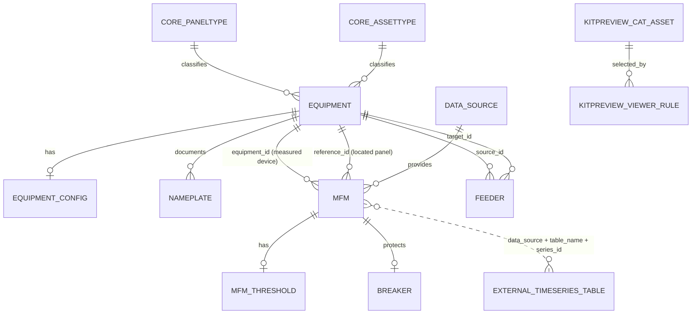

# Additional Data Used for MFMs

This document lists the non-timeseries data used alongside each MFM. These
values provide identity, topology, nameplate ratings, operating references,
thresholds and correction rules. They are combined with raw MFM readings before
the backend builds frontend payloads.

## Database schema and connections

### Relationship diagram



`EXTERNAL_TIMESERIES_TABLE` is conceptual in this diagram. It is not a Django
model and there is no database foreign-key constraint from `mfm` to a logger
table. The backend resolves it dynamically.

### Core relational tables

| Database table | Primary key | Important columns | Relationship/purpose |
|---|---|---|---|
| `mfm` | `id` | `name`, `role`, `equipment_id`, `reference_id`, `data_source_id`, `table_name`, `series_id` | Central panel-side meter record. Connects a logical meter to equipment, location and physical telemetry. |
| `equipment` | `id` | `key`, `name`, `panel_type_id`, `asset_type_id`, `distribution_panel`, `metered`, `group` | Canonical record for every panel or asset. Exactly one of `panel_type_id` and `asset_type_id` must be set. |
| `core_paneltype` | `id` | `code`, `name` | Classifies panel equipment. The type code selects configuration defaults and WebSocket behavior. |
| `core_assettype` | `id` | `code`, `name` | Classifies asset equipment such as DG or UPS. |
| `equipment_config` | `id` | `equipment_id` plus ratings, limits and targets | One-to-one configuration for an equipment row. Non-null values override type defaults. |
| `data_source` | `id` | `name`, `dsn` | Shared connection to a physical timeseries database. Many MFMs can use one source. |
| `mfm_threshold` | `id` | `mfm_id` plus PQ and Overview thresholds | Optional one-to-one, finest-grain threshold overrides for a specific MFM. |
| `breaker` | `id` | `mfm_id`, `breaker_type`, `rating_a`, provenance fields | Optional one-to-one static breaker metadata for an MFM. |
| `feeder` | `id` | `source_id`, `target_id`, `kind`, `label`, `metered` | Directed equipment-to-equipment electrical topology. It does not point directly to an MFM. |
| `nameplate` | `id` | `equipment_id`, `key`, `value`, `unit`, `normalized_value`, `confidence`, `source` | OCR/reference nameplate facts. Informational only; they do not override `equipment_config`. |

### MFM table structure

The concrete `mfm` table inherits the shared `MeterBase` fields and adds
per-meter electrical nameplate overrides.

```text
mfm
|-- id                         PK
|-- name
|-- equipment_id              FK -> equipment.id, nullable, SET NULL
|-- reference_id              FK -> equipment.id, required, CASCADE
|-- role
|-- data_source_id            FK -> data_source.id, nullable, PROTECT
|-- table_name
|-- series_id
|-- energy_direction
|-- energy_scale
|-- power_scale
|-- asset_category
|-- load_profile
|-- parent_series
|-- rated_capacity_kva
|-- nominal_voltage_v
|-- nameplate_voltage_kv
|-- frequency_hz
|-- fault_level_ka
|-- sheet_row
|-- section
|-- zone
|-- created_at
`-- updated_at
```

The two equipment foreign keys have different meanings:

```text
mfm.equipment_id -> what this meter measures
mfm.reference_id -> where this meter is physically installed
```

Example for TF-1 LV:

```text
mfm.id           = 26
mfm.equipment_id -> equipment(key='tx-01')   # measured transformer
mfm.reference_id -> equipment(key='pcc-1a')  # panel containing the meter
```

Deleting the located panel cascades to its MFM records because an MFM cannot
exist without a physical location. Deleting the mapped device sets
`equipment_id` to null so the meter/location record can remain.

### Equipment table structure

```text
equipment
|-- id                  PK
|-- name
|-- key                 unique stable frontend identifier
|-- panel_type_id       FK -> core_paneltype.id, nullable, PROTECT
|-- asset_type_id       FK -> core_assettype.id, nullable, PROTECT
|-- distribution_panel
|-- metered
|-- group
|-- created_at
`-- updated_at
```

A database check constraint enforces:

```text
panel_type_id IS NOT NULL AND asset_type_id IS NULL
OR
panel_type_id IS NULL AND asset_type_id IS NOT NULL
```

This gives every equipment row one unambiguous type family.

### Equipment configuration table

`equipment_config.equipment_id` is one-to-one with `equipment.id`.

```text
equipment_config
|-- id                          PK
|-- equipment_id                unique FK -> equipment.id
|-- rated_kva
|-- rated_kw
|-- contracted_kw
|-- critical_load_kw
|-- nominal_voltage_v
|-- voltage_statutory_deviation_pct
|-- rated_current_a
|-- current_tolerance_pct
|-- current_unbalance_watch_pct
|-- current_high_threshold_a
|-- energy_target_kwh_today
|-- demand_limit_kw
|-- subsidy_limit_kw
|-- subsidy_limit_mvah
|-- target_efficiency_pct
|-- thd_v_limit_pct
|-- thd_i_limit_pct
|-- true_pf_min
|-- neutral_current_limit_a
|-- vc_vdev_warn_pct / vc_vdev_danger_pct
|-- vc_iunbal_warn_pct / vc_iunbal_danger_pct
|-- frequency_hz
|-- fault_level_ka
|-- nameplate_voltage_kv
|-- rating
|-- notes
`-- updated_at
```

All electrical override fields are nullable. A null means "continue to the
type default/fallback," not zero.

### Per-MFM threshold table

`mfm_threshold.mfm_id` is a unique one-to-one foreign key to `mfm.id`.

```text
mfm_threshold
|-- id                                      PK
|-- mfm_id                                  unique FK -> mfm.id, CASCADE
|-- i_thd_limit_pct
|-- v_thd_limit_pct
|-- individual_harmonic_limit_pct
|-- flicker_pst_limit
|-- crest_factor_ideal
|-- overview_busbar_temp_warn_c
|-- overview_busbar_temp_critical_c
|-- overview_load_elevated_pct
|-- overview_load_critical_pct
|-- overview_pf_good
|-- overview_pf_fair
|-- overview_freq_nominal_hz
|-- overview_freq_fair_dev_hz
|-- overview_freq_unstable_dev_hz
|-- overview_phase_watch_pct
|-- overview_phase_unbalanced_pct
|-- overview_voltage_dev_elevated_pct
|-- overview_voltage_dev_critical_pct
|-- overview_energy_elevated_pct
|-- overview_energy_critical_pct
`-- updated_at
```

Because this table is attached directly to `mfm`, its non-null values have
higher precedence than equipment/type threshold defaults.

### Data-source to timeseries connection

The relational database stores metadata; the electrical readings live in a
separate timeseries database. The connection is resolved as follows:

```text
mfm.data_source_id
  -> data_source.id
  -> data_source.dsn
  -> connect to the physical timeseries database

mfm.table_name
  -> select the logger table

mfm.series_id
  -> optionally restrict rows within that table
```

Conceptual query flow:

```sql
SELECT <required endpoint columns>
FROM <mfm.table_name>
WHERE series_id = <mfm.series_id>  -- only when configured
ORDER BY timestamp DESC;
```

After reading rows, the service layer applies `energy_direction`,
`energy_scale`, `power_scale`, schema aliases and null handling. Consumers then
perform endpoint-specific derivation or aggregation.

### Topology connection

The `feeder` table connects equipment, not meters:

```text
feeder.source_id -> equipment.id   # upstream equipment
feeder.target_id -> equipment.id   # downstream equipment
```

An MFM participates in topology indirectly through `mfm.equipment_id` and
`mfm.reference_id`. This separation permits:

- an electrical connection without a meter;
- several meters around one equipment;
- a meter physically located in one panel while measuring another device;
- topology changes without changing the physical timeseries mapping.

For input/output calculations, the backend uses the equipment graph and then
finds the MFM records mapped to or located at the related equipment.

### Breaker connection

```text
breaker.mfm_id -> mfm.id
```

The relationship is one-to-zero-or-one. Deleting the MFM cascades to the
breaker metadata. `breaker_type` and `rating_a` are static equipment facts;
they must not be confused with live breaker state from telemetry.

### Reference nameplate connection

```text
nameplate.equipment_id -> equipment.id
```

One equipment can have many nameplate key/value rows. The unique key is
`(equipment_id, key)`. These rows preserve extracted label text, normalized
value, unit, confidence and source for traceability.

`nameplate` is reference data only. The operational screens use the resolved
`equipment_config` values; an OCR nameplate row never overrides them.

### Viewer-schema connection

The 3D viewer uses separate catalog tables:

| Table | Connection |
|---|---|
| `kitpreview_viewer_rule` | Matches `equipment.key` through `for_key`, or the equipment type code through `for_type`. These are logical string bindings, not equipment FKs. |
| `kitpreview_cat_asset` | Referenced by `kitpreview_viewer_rule.model_id`; stores the GLB file/URL, default viewer overrides and template. |
| `kitpreview_app_kv` | Stores global viewer defaults and fallback settings. |

Viewer resolution order is:

```text
ViewerRule.for_key == equipment.key
  -> ViewerRule.for_type + EquipmentConfig.rating
  -> ViewerRule.for_type default
  -> global default panel model
```

The selected model's defaults are deep-merged with the rule preset and global
viewer defaults.

### End-to-end join path

For a frontend request such as:

```text
/ws/mfm/1000026/voltage-history/
```

the backend follows this path:

```text
1. Remove the 1,000,000 feeder offset
   1000026 -> mfm.id 26

2. Load mfm(26)
   - mapped equipment_id
   - located reference_id
   - data_source_id, table_name, series_id
   - rating/nameplate overrides and correction rules

3. Resolve equipment configuration
   equipment_config(mapped equipment)
   -> equipment/panel-type defaults
   -> MFM rating and nominal overrides
   -> mfm_threshold overrides

4. Open the timeseries source
   data_source.dsn + mfm.table_name (+ series_id)

5. Read the endpoint's required MFM fields
   e.g. phase voltages and deviation columns

6. Correct and aggregate readings
   direction/scale rules -> requested time buckets -> KPIs

7. Combine data and configuration
   measured history + nominal voltage + allowed-deviation band

8. Send the WebSocket JSON frame
```

## 1. MFM identity and placement

Stored directly on the `MFM` record or its related equipment.

| Field | Meaning | Typical use |
|---|---|---|
| `id` | Internal database MFM ID. | Used to create the frontend ID: `1_000_000 + MFM.id`. |
| `name` | Display name of the metered feeder/device. | Page title, navigation and response metadata. |
| `role` | `incoming`, `outgoing`, `spare`, or `coupler`. | Navigation grouping and input/output calculations. |
| `equipment` | Device measured by the MFM. | Determines equipment type and primary configuration source. |
| `reference` | Panel in which the MFM is located. | Determines parent panel and fallback configuration. |
| `asset_category` | Metered equipment category. | Classification and dispatch. |
| `load_profile` | Optional load category such as UPS-backed or HVAC. | Grouping and analysis context. |
| `parent_series` | Upstream meter's logger-series identifier. | Parent/input meter relationships. |
| `sheet_row` | Source row from the master mapping sheet. | Provenance and stable ordering. |
| `section` | Plant/electrical section. | Navigation and grouping. |
| `zone` | Physical or logical plant zone. | Navigation and grouping. |

## 2. Timeseries source information

These fields tell the backend where the MFM readings are stored.

| Field | Meaning |
|---|---|
| `data_source` | Shared database connection containing the timeseries. |
| `table_name` | Physical logger table for the MFM. |
| `series_id` | Optional identifier used when a table contains multiple series. |

These fields are backend wiring. They are not normally returned to the
frontend.

## 3. Meter correction rules

These fields correct logger/register behavior before readings reach any API or
WebSocket.

| Field | Meaning | Applied to |
|---|---|---|
| `energy_direction` | Selects `import`, `export`, `sum`, or `net` as the true energy register. | Active-energy values and deltas. |
| `energy_scale` | Corrects an energy-register CT/PT multiplier error. | Energy only. |
| `power_scale` | Corrects a power-register multiplier error. | kW, kVAr and kVA only. |

Voltage and current are not changed by `energy_scale` or `power_scale`.

## 4. Per-MFM nameplate fields

These values are stored directly on an individual MFM when the mapped equipment
configuration is not specific enough. This is important when two meters read
different voltage sides of the same transformer.

| Field | Unit | Meaning |
|---|---:|---|
| `rated_capacity_kva` | kVA | Apparent-power rating of the feeder/device measured by this MFM. |
| `nominal_voltage_v` | V L-L | Per-meter nominal line-to-line voltage. |
| `nameplate_voltage_kv` | kV L-L | Explicit nameplate voltage displayed in the UI. |
| `frequency_hz` | Hz | Per-meter nominal system frequency. |
| `fault_level_ka` | kA | Per-meter switchgear short-circuit/fault level. |

Per-MFM values override inherited equipment or panel values.

## 5. Equipment nameplate and capacity configuration

These values normally come from `EquipmentConfig` for the mapped equipment.
They can also be derived from `MFM.rated_capacity_kva` for a feeder.

| Field | Unit | Meaning and use |
|---|---:|---|
| `rated_kva` | kVA | Apparent-power nameplate capacity. Used for utilization, headroom and rated current. |
| `rated_kw` | kW | Real-power capacity. Used for load percentage, chart scaling and energy capacity. |
| `contracted_kw` | kW | Contracted demand reference used in demand analysis. |
| `critical_load_kw` | kW | Critical-load reference used in capacity/status calculations. |
| `target_efficiency_pct` | % | Target efficiency reference for input/output calculations. |
| `rating` | Text | Nameplate tag used to select the appropriate 3D model variant. |

### Feeder rating derivation

When `rated_capacity_kva` is available, feeder-level values are derived as:

```text
rated_kva       = MFM.rated_capacity_kva
rated_kw        = rated_kva x 0.9
contracted_kw   = rated_kw x 0.9
critical_load_kw = rated_kw x 0.5
```

The `0.9` kVA-to-kW conversion is the backend's feeder power-factor assumption.

## 6. Voltage configuration

| Field | Unit | Meaning and use |
|---|---:|---|
| `nominal_voltage_v` | V | Nominal voltage used for deviation calculations and voltage bands. |
| `voltage_nominal_v` | V | Frontend-compatible alias for `nominal_voltage_v`. |
| `nameplate_voltage_kv` | kV | Explicit system/nameplate voltage shown in headers. |
| `voltage_statutory_deviation_pct` | % | Permitted deviation around nominal voltage. |
| `vc_vdev_warn_pct` | % | Warning boundary for voltage deviation. |
| `vc_vdev_danger_pct` | % | Danger boundary for voltage deviation. |

### Nominal-voltage precedence

For a feeder/MFM, the backend resolves the real L-L nominal in this order:

```text
1. MFM.nominal_voltage_v
2. mapped equipment's explicit nominal voltage
3. located panel's nominal voltage
4. equipment/panel-type default
```

### L-L versus L-N convention

- Per-MFM stored `nominal_voltage_v` is line-to-line.
- Feeder configuration responses expose `nominal_voltage_v` and
  `voltage_nominal_v` on a line-to-neutral basis.
- Distribution-panel configuration responses expose their stored line-to-line
  nominal directly.

For a feeder:

```text
nominal_voltage_L-N = nominal_voltage_L-L / sqrt(3)
```

Example:

```text
415 V L-L / sqrt(3) = 239.6 V L-N
```

## 7. Current configuration

| Field | Unit | Meaning and use |
|---|---:|---|
| `rated_current_a` | A | Full-load current reference. |
| `current_high_threshold_a` | A | High-current boundary, normally 120% of rated current. |
| `current_tolerance_pct` | % | Permitted current tolerance. |
| `current_unbalance_watch_pct` | % | Current-unbalance watch threshold where configured. |
| `vc_iunbal_warn_pct` | % | Warning boundary for current unbalance. |
| `vc_iunbal_danger_pct` | % | Danger boundary for current unbalance. |
| `neutral_current_limit_a` | A | Neutral-current stress threshold. |

### Rated-current derivation

```text
rated_current_a = rated_kva x 1000 / (sqrt(3) x nominal_voltage_L-L)
current_high_threshold_a = rated_current_a x 1.2
```

The current-balance classifier also uses a CT-noise deadband:

```text
current_deadband_a = max(rated_current_a x 0.01, 1 A)
```

Below this deadband, the backend can classify the MFM as `Idle` instead of
treating measurement noise as a real phase-unbalance condition.

## 8. Energy and demand configuration

| Field | Unit | Meaning and use |
|---|---:|---|
| `energy_target_kwh_today` | kWh | Daily energy target/capacity used by progress cards. |
| `demand_limit_kw` | kW | Demand-limit reference line where configured. |
| `subsidy_limit_kw` | kW | Panel-level subsidy/power limit. |
| `subsidy_limit_mvah` | MVAh | Panel-level cumulative-energy subsidy limit. |

For a feeder with a resolved rating:

```text
energy_target_kwh_today = rated_kw x 24 hours
```

For selected-period energy summaries, capacity is calculated using the complete
window:

```text
period_energy_capacity_kwh = rated_kw x full_window_hours
```

## 9. Power-quality configuration

| Field | Unit | Meaning and use |
|---|---:|---|
| `thd_v_limit_pct` | % | Voltage THD limit. |
| `thd_i_limit_pct` | % | Current THD limit. |
| `ieee_519_voltage_thd_limit_pct` | % | Frontend-compatible voltage THD limit alias. |
| `ieee_519_current_thd_limit_pct` | % | Frontend-compatible current THD limit alias. |
| `ieee_519_individual_harmonic_limit_pct` | % | Limit for H5, H7 and other individual harmonics. |
| `true_pf_min` | ratio | Minimum acceptable true power factor. |
| `flicker_pst_limit` | Pst | Flicker warning/reference limit. |
| `crest_factor_ideal` | ratio | Ideal voltage crest factor, normally 1.414. |

The `ieee_519_*` keys are frontend-facing aliases/defaults. The source values
come from equipment configuration or per-MFM thresholds.

## 10. Per-MFM thresholds

Each MFM can have a one-to-one `MfmThreshold` row. Non-null values here override
equipment/type defaults.

### Power-quality thresholds

```text
i_thd_limit_pct
v_thd_limit_pct
individual_harmonic_limit_pct
flicker_pst_limit
crest_factor_ideal
```

### Overview status thresholds

```text
overview_busbar_temp_warn_c
overview_busbar_temp_critical_c
overview_load_elevated_pct
overview_load_critical_pct
overview_pf_good
overview_pf_fair
overview_freq_nominal_hz
overview_freq_fair_dev_hz
overview_freq_unstable_dev_hz
overview_phase_watch_pct
overview_phase_unbalanced_pct
overview_voltage_dev_elevated_pct
overview_voltage_dev_critical_pct
overview_energy_elevated_pct
overview_energy_critical_pct
```

These thresholds convert numeric readings into frontend labels such as
`Normal`, `Elevated`, `Critical`, `Good`, `Fair`, `Stable`, `Watch`,
`Balanced`, and `Unbalanced`.

## 11. Frequency and fault-level configuration

| Field | Unit | Meaning |
|---|---:|---|
| `frequency_hz` | Hz | Nominal system frequency, normally 50 Hz. |
| `fault_level_ka` | kA | Switchgear fault/short-circuit level displayed in equipment details. |

The frequency reference is also used to derive live frequency deviation:

```text
frequency_deviation_hz = measured_frequency_hz - nominal_frequency_hz
```

## 12. Topology and related-meter data

Some values cannot be calculated from one MFM alone.

| Supporting data | Used for |
|---|---|
| MFM `role` | Determines whether the meter represents input, output, spare or coupling. |
| MFM `reference` | Identifies the panel containing the MFM. |
| MFM `equipment` | Identifies the measured downstream device. |
| MFM `parent_series` | Connects the meter to an upstream series. |
| `Feeder` source/target graph | Finds upstream input and downstream consumers. |
| Related MFM readings | Input/output loss, feeder share, SEC and energy reconciliation. |

Topology-based calculations include:

```text
active_power_loss_kw  = input_kw - output_kw
active_power_loss_pct = active_power_loss_kw / input_kw x 100
feeder_share_pct      = feeder_energy / panel_incoming_energy x 100
SEC                   = upstream_active_energy / downstream_active_energy
```

These calculations remain null when the required related meter or valid reading
is unavailable.

## 13. Breaker metadata

The optional `Breaker` record adds:

```text
breaker_type: ACB | MCCB | MCB | VCB | unknown
rating_a
source
glb_node
panel_key
```

This is static equipment metadata derived from the panel model/mapping. It does
not indicate the live breaker state. Live breaker state must come from a
timeseries or digital-status field.

## 14. Viewer metadata

The mapped equipment can also resolve a 3D viewer configuration containing:

```text
object slug, label, URL and rating variant
camera position and zoom
lighting and environment
edge and bloom settings
labels/pills
animation and flow configuration
```

Viewer metadata is presentation data. It does not affect electrical formulas.

## 15. Configuration resolution order

The complete effective configuration is assembled approximately as follows:

```text
equipment/panel-type defaults
  -> mapped EquipmentConfig non-null overrides
  -> MFM rated_capacity_kva derived feeder ratings
  -> per-MFM nominal/frequency/fault-level overrides
  -> per-MFM MfmThreshold overrides
  -> frontend-compatible aliases and defaults
```

For a feeder, the mapped equipment is the primary configuration subject. The
located panel supplies context or a fallback where necessary.

## 16. Configuration API

Resolved frontend configuration is available from:

```text
GET /api/mfm/{frontend_mfm_id}/config/
```

Example envelope:

```jsonc
{
  "mfm_id": 1000026,
  "panel_id": "tx-01",
  "mfm_type": "transformer",
  "config_table": "equipment_config",
  "config": {
    "rated_kva": 2500,
    "rated_kw": 2250,
    "contracted_kw": 2025,
    "critical_load_kw": 1125,
    "nominal_voltage_v": 239.6,
    "voltage_nominal_v": 239.6,
    "rated_current_a": 3478,
    "current_high_threshold_a": 4174,
    "energy_target_kwh_today": 54000,
    "frequency_hz": 50,
    "thd_v_limit_pct": 8,
    "thd_i_limit_pct": 8
  },
  "object": {
    "slug": "1000xacb-panel",
    "label": "1000xACB_panel",
    "url": "/media/objects/1000xacb-panel.glb",
    "rating": null
  }
}
```

## 17. TF-1 LV example

For frontend MFM `1000026`:

| Item | Resolved value |
|---|---:|
| Database MFM ID | 26 |
| Name | Tf-1 (LV) |
| Role | Incoming |
| Located panel | `pcc-1a` |
| Mapped equipment | `tx-01` |
| MFM type | `transformer` |
| Timeseries table | `pqm_transformer_1_incomer_pcc_01` |
| Rated apparent power | 2500 kVA |
| Rated real power | 2250 kW |
| Contracted power | 2025 kW |
| Critical load | 1125 kW |
| Nominal voltage sent to feeder UI | 239.6 V L-N |
| Equivalent system voltage | 415 V L-L |
| Rated current | 3478 A |
| High-current threshold | 4174 A |
| Daily energy capacity/target | 54000 kWh |
| Nominal frequency | 50 Hz |
| Voltage THD limit | 8% |
| Current THD limit | 8% |
| Individual harmonic limit | 8% |
| Flicker Pst limit | 1.0 |
| Ideal crest factor | 1.414 |
