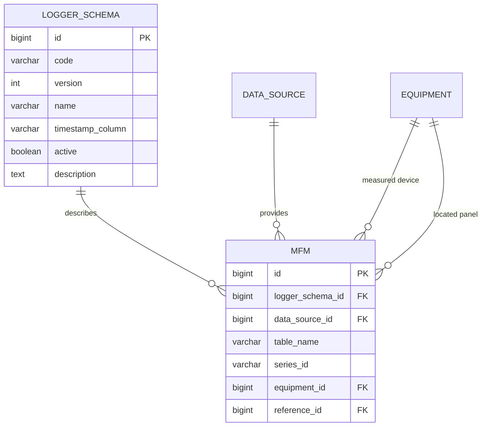

# Step 1: Add a Logger Schema Type and Connect It to MFM

## Status

Design document only. No model, migration, admin, service, or consumer code has
been changed as part of this step.

## Goal

Introduce a reusable logger-schema identity and assign each MFM to one schema:

```text
many MFMs -> one LoggerSchema
```

Example:

```text
MFM:           Tf-1 (LV)
Logger table:  pqm_transformer_1_incomer_pcc_01
Logger schema: pm8000, version 1
```

Another MFM can reuse this schema when its physical logger fields have the same
names, units and meanings. Its electrical ratings and limits remain independent.

## Scope

Step 1 includes only:

1. A new `logger_schema` table.
2. A nullable foreign key from `mfm` to `logger_schema`.
3. Schema lifecycle and deletion rules.
4. Admin assignment behavior.
5. A migration and backfill plan.

Step 1 does not include:

- canonical field definitions;
- physical field mappings;
- service-layer changes;
- consumer changes;
- automatic schema detection;
- per-MFM field overrides;
- moving ratings or thresholds into the schema.

Those belong in later steps.

## Ownership boundary

### Logger schema owns

Only reusable information about the physical logger layout:

```text
schema family code
schema version
display name and description
default timestamp-column name
active/retired state
```

### MFM continues to own

```text
data_source_id
table_name
series_id
energy_direction
energy_scale
power_scale
rated_capacity_kva
nominal_voltage_v
nameplate_voltage_kv
frequency_hz
fault_level_ka
equipment_id
reference_id
role
```

### Per-MFM/equipment configuration continues to own

```text
rated_kva
rated_kw
contracted_kw
critical_load_kw
nominal voltage
rated current
energy target
THD limits
status thresholds
```

Two MFMs using the same logger schema can have completely different values for
all of the above.

## Proposed database schema

### New table: `logger_schema`

```text
logger_schema
|-- id                    BIGINT, primary key
|-- code                  VARCHAR(64), required
|-- version               positive integer, required, default 1
|-- name                  VARCHAR(120), required
|-- timestamp_column      VARCHAR(100), required, default "timestamp"
|-- description           TEXT, optional
|-- active                BOOLEAN, required, default true
|-- created_at            timestamp
`-- updated_at            timestamp
```

Recommended uniqueness:

```text
UNIQUE(code, version)
```

Store the family and version separately:

```text
code    = pm8000
version = 1
display = pm8000_v1
```

### New column on `mfm`

```text
mfm.logger_schema_id
    nullable FK -> logger_schema.id
    ON DELETE PROTECT
```

It should initially be nullable so existing MFM records remain valid while
schemas are created, verified and assigned.

## Relationship diagram



## Why the foreign key belongs on MFM

The logger format belongs to the meter-to-table integration, not necessarily to
the measured equipment.

Two identical transformers can use different logger families:

```text
Transformer A MFM -> PM8000 schema
Transformer B MFM -> Schneider SE schema
```

Different equipment can also reuse the same logger layout:

```text
Transformer MFM -> PM8000 schema
PCC incomer MFM -> PM8000 schema
UPS incomer MFM -> PM8000 schema
```

Therefore, the relationship should be `MFM -> LoggerSchema`, not
`Equipment -> LoggerSchema`.

## Illustrative Django design

This is proposed design code for a later implementation. It is not currently
applied to the repository.

```python
class LoggerSchema(models.Model):
    code = models.SlugField(max_length=64)
    version = models.PositiveIntegerField(default=1)
    name = models.CharField(max_length=120)
    timestamp_column = models.CharField(max_length=100, default="timestamp")
    description = models.TextField(blank=True, default="")
    active = models.BooleanField(default=True)
    created_at = models.DateTimeField(auto_now_add=True)
    updated_at = models.DateTimeField(auto_now=True)

    class Meta:
        db_table = "logger_schema"
        ordering = ["code", "version"]
        constraints = [
            models.UniqueConstraint(
                fields=["code", "version"],
                name="uniq_logger_schema_code_version",
            ),
            models.CheckConstraint(
                condition=models.Q(version__gte=1),
                name="logger_schema_version_gte_1",
            ),
        ]

    def __str__(self):
        return f"{self.name} ({self.code}_v{self.version})"
```

Proposed MFM addition:

```python
class MFM(MeterBase):
    logger_schema = models.ForeignKey(
        LoggerSchema,
        null=True,
        blank=True,
        on_delete=models.PROTECT,
        related_name="mfms",
    )
```

## Naming rules

Use stable logger-family codes:

```text
pm8000
schneider_se
elite_440
simulator_mfm
```

Avoid equipment-specific schema codes:

```text
Bad:  tf1_lv_schema
Bad:  pcc1a_2500kva
Good: pm8000, version 1
```

The schema describes a reusable field layout. It should not identify one MFM,
panel or electrical rating.

## When MFMs may share a schema

MFMs may use the same schema only when these are compatible:

- physical field names;
- physical units;
- field meanings;
- timestamp representation;
- required multi-column calculations;
- null/sentinel conventions that belong to the logger family.

Sharing a logger model name alone is not enough if different firmware or export
configurations produce incompatible columns.

## Versioning rules

Treat an assigned schema version as an immutable contract.

Create a new version when any of these changes incompatibly:

- physical column names;
- units or scale;
- timestamp format or name;
- field meaning;
- required fields;
- multi-column calculation rules.

Example:

```text
pm8000, version 1
pm8000, version 2
```

Do not silently redefine version 1 after MFMs use it. Migrate MFMs from version
1 to version 2 individually after validation.

These changes do not require a new logger schema:

- a different MFM table name;
- a different data source;
- a different rated kVA/kW;
- a different nominal voltage;
- different targets or thresholds.

## Delete and retirement behavior

Use `ON DELETE PROTECT` / Django `models.PROTECT`.

Deleting an assigned schema should fail:

```text
Cannot delete pm8000_v1 because 18 MFMs reference it.
Reassign those MFMs or retire the schema.
```

Prefer retirement:

```text
logger_schema.active = false
```

Retirement means:

- assigned MFMs continue to work;
- the schema cannot be selected for new assignments;
- administrators can inspect and migrate existing assignments;
- historical configuration remains understandable.

An inactive schema may be deleted only when no MFM references it.

## Timestamp column

The timestamp name is part of the physical logger layout and can be stored on
the schema in Step 1.

Examples:

```text
pm8000_v1       -> timestamp
loggerfast_v1   -> timestamp_utc
legacy_meter_v1 -> datetime
```

During later service integration, resolution should be:

```text
1. logger_schema.timestamp_column
2. existing automatic timestamp aliases
3. explicit validation error if nothing resolves
```

## Migration strategy

Use staged migrations so current endpoints are not interrupted.

### Migration A: create `logger_schema`

Create the schema table without changing MFM fetch behavior.

Expected result:

```text
No HTTP or WebSocket behavior change.
```

### Migration B: add nullable MFM foreign key

Add `mfm.logger_schema_id` as nullable and protected.

Expected result:

```text
Existing MFMs remain valid.
Existing service aliases continue to resolve fields.
```

### Data migration: seed schema identities

Create only verified schema families, for example:

```text
pm8000, version 1
schneider_se, version 1
elite_440, version 1
simulator_mfm, version 1
```

The detailed field blueprint is not added until Step 2.

### Backfill MFM assignments

Assign schemas using verified evidence:

- logger/device family;
- audited mapping sheet;
- actual `information_schema.columns` signature;
- a deterministic, verified table naming rule.

Do not infer the schema from equipment type alone.

Example result:

```text
mfm 26 / pqm_transformer_1_incomer_pcc_01 -> pm8000 v1
mfm 27 / another compatible table         -> pm8000 v1
mfm 40 / schneider table                  -> schneider_se v1
```

### Produce a validation report

Before considering a non-null foreign key, report:

```text
total MFMs
MFMs with data_source and table_name
MFMs assigned to a logger schema
active MFMs without a schema
MFMs assigned to inactive schemas
tables whose timestamp does not match their assigned schema
```

### Optional later migration: require a schema

Only consider making `logger_schema_id` non-null after all actively queried
MFMs have verified assignments.

It may remain nullable permanently if placeholder/unwired MFMs are valid in the
system.

## Admin workflow

### Add a logger schema

Administrator input:

```text
Code:             pm8000
Version:          1
Name:             PM8000 Schema v1
Timestamp column: timestamp
Description:      Standard PM8000 electrical logger layout
Active:           yes
```

Validation should reject:

- duplicate `(code, version)`;
- empty code or name;
- version less than 1;
- unsafe timestamp identifiers.

Use a safe SQL-identifier rule for `timestamp_column`:

```regex
^[A-Za-z_][A-Za-z0-9_]*$
```

### Connect the schema to an MFM

MFM administration example:

```text
MFM:           Tf-1 (LV)
Data source:   premier_energies
Table:         pqm_transformer_1_incomer_pcc_01
Logger schema: PM8000 Schema v1
```

Only active schemas should be selectable for a new assignment. An inactive
schema already assigned to an MFM should remain visible until migration.

### Change an assignment

Recommended workflow:

```text
select candidate schema
  -> validate against MFM data_source + table_name
  -> display validation result
  -> confirm assignment
```

In Step 1, validation can verify the timestamp column. Step 2 can validate all
required field mappings.

## Optional API representation

The resolved schema identity may later be exposed through MFM configuration:

```jsonc
{
  "mfm_id": 1000026,
  "mfm_type": "transformer",
  "logger_schema": {
    "id": 1,
    "code": "pm8000",
    "version": 1,
    "name": "PM8000 Schema v1",
    "timestamp_column": "timestamp",
    "active": true
  },
  "config": {
    "rated_kva": 2500,
    "nominal_voltage_v": 239.6
  }
}
```

The frontend does not need this field to render current screens. The backend
should continue returning canonical telemetry names.

## Service behavior during Step 1

Do not use `mfm.logger_schema_id` for telemetry resolution yet.

Current behavior remains:

```text
consumer canonical fields
  -> current core.services schema inspection and aliases
  -> physical logger table
```

Step 1 only establishes schema identity and MFM assignment. Step 2 defines the
field blueprint, and a later implementation step switches the service layer to
that blueprint.

This keeps Step 1 independently deployable and easy to roll back.

## Validation rules

### Logger schema

```text
code must be non-empty
(code, version) must be unique
version must be at least 1
name must be non-empty
timestamp_column must be a safe identifier
inactive schemas cannot receive new assignments
```

### MFM assignment

```text
MFM should have a data source
MFM should have a table name
assigned schema must exist
newly assigned schema must be active
configured timestamp column should exist in the physical table
```

Validation failures should be reported. The system should not silently guess a
different schema.

## Indexes and constraints

Recommended database rules:

```text
UNIQUE logger_schema(code, version)
CHECK logger_schema.version >= 1
INDEX logger_schema(active)
INDEX mfm(logger_schema_id)
FK mfm.logger_schema_id -> logger_schema.id ON DELETE PROTECT
```

## TF-1 LV assignment example

```text
mfm.id                  = 26
frontend mfm_id         = 1000026
mfm.name                = Tf-1 (LV)
mfm.data_source         = premier_energies
mfm.table_name          = pqm_transformer_1_incomer_pcc_01
mfm.logger_schema       = pm8000, version 1
mfm.rated_capacity_kva  = 2500               # remains per MFM
mfm.nominal_voltage_v   = per-MFM value/null # remains per MFM
```

The assignment says only that the table follows the PM8000 v1 field blueprint.
It does not assign ratings, voltage, energy targets or thresholds to other
PM8000 MFMs.

## Rollback plan

Because services do not depend on the new FK during Step 1:

1. Stop assigning schemas.
2. Clear `mfm.logger_schema_id` values if necessary.
3. Remove the protected foreign key and column.
4. Drop `logger_schema` after references are removed.

No logger data, MFM mappings, ratings, or thresholds need rewriting.

## Acceptance criteria

Step 1 is complete when:

- `logger_schema` exists with identity, version, timestamp and lifecycle data;
- `mfm.logger_schema_id` exists as a nullable protected foreign key;
- administrators can create and retire schema types;
- administrators can assign an active schema to an MFM;
- an assigned schema cannot be deleted;
- current HTTP and WebSocket behavior is unchanged;
- a report identifies active MFMs without schema assignments;
- TF-1 LV can be assigned to its verified schema;
- no rating, nominal voltage, target or threshold has moved into the schema.

## Next step

Step 2 should define the reusable field blueprint:

```text
LoggerSchema
  -> LoggerSchemaField
  -> CanonicalField
```

That design will cover physical columns, operations, units, scaling and
required fields. It should begin only after the Step 1 ownership and lifecycle
rules are accepted.

