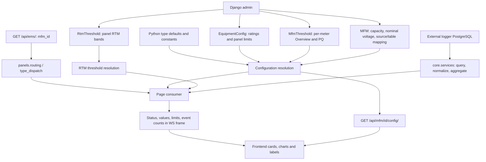

# EMS page thresholds, admin configuration, and code architecture

Code review date: 2026-09-29.

> Implementation note for this checkout: this is the supplied reference
> specification. See [THRESHOLD_IMPLEMENTATION.md](THRESHOLD_IMPLEMENTATION.md)
> for the Group-ID/model-path adaptations, implemented rules, compatible payload
> fields, and explicitly deferred non-threshold features.

## 1. Scope and how to read this document

This document describes the **implemented backend behavior** for the distribution-panel and single-MFM pages listed below. It excludes `/ws/asset/`, `/ws/meter/`, BMS pages, and asset-domain thresholds. An EMS meter may measure a UPS or transformer; that still uses the EMS rules described here.

User-provided deployment origins:

- HTTP: `http://10.80.200.2:18889`
- WebSocket: `ws://10.80.200.2:18889`

**Values here are source-code defaults, model defaults, or explicit formulas—not an export of the deployed database.** Admin overrides can change effective values. The deployment at these origins was not queried for this document, and its code version was not verified. Frontend rendering, colors, and any additional frontend-only classifiers are not verified here.

Distinguish four different things:

1. **Measured value:** logger reading, such as voltage or THD.
2. **Reference/limit:** configured rating, target, or threshold.
3. **Classification:** backend comparison returning `Critical`, `warning`, `High`, etc.
4. **Event:** entering a violation region, counted over a time window.

A rating or chart line does not automatically generate an alarm. A field named `critical_load_kw` is not the same as a status string `Critical`. These rules describe monitoring and presentation; they do not establish a protection-trip or control action.

## 2. Page and endpoint inventory

Use the `mfm_id` returned by `/api/ems/` unchanged in HTTP and WebSocket URLs.

### 2.1 Distribution panels

| Page | WebSocket suffix after `/ws/mfm/<panel-id>/` | Main implementation |
|---|---|---|
| Overview | `energy-distribution/` | `panels/consumers/energydist.py` |
| Real-Time Monitoring | `real-time-monitoring/` | `panels/consumers/realtime.py` |
| Energy & Distribution | `energy-distribution/` | `panels/consumers/energydist.py` |
| Energy & Power | `energy-power/` | `panels/consumers/energypower.py` |
| Voltage & Current | `voltage-current/` | `panels/consumers/voltagecurrent.py` |
| Harmonics & PQ | `power-quality-summary/` | `panels/consumers/powerquality.py` |

Six pages share five distinct endpoints. There is no distribution-panel `overview/` route in this screen set.

### 2.2 Single MFMs

| Page | Widget | WebSocket suffix after `/ws/mfm/<mfm-id>/` | Main implementation |
|---|---|---|---|
| Overview | Cards and phase readings | `overview/` | `feeder_overview.py` |
| Real-Time Monitoring | Live readings | `real-time-monitoring/` | `feeder_realtime.py` |
| Energy & Power | Live readings | `energy-power/` | `feeder_energypower.py` |
| Energy & Power | Energy summary | `energy-summary/` | `feeder_energysummary.py` |
| Energy & Power | Power/energy analysis | `power-energy-analysis/` | `feeder_powerenergyanalysis.py` |
| Energy & Power | Load anomalies | `load-anomalies/` | `feeder_loadanomalies.py` |
| Voltage & Current | Live readings | `voltage-current/` | `feeder_voltagecurrent.py` |
| Voltage & Current | Voltage history | `voltage-history/` | `feeder_history.py` |
| Voltage & Current | Current history | `current-history/` | `feeder_history.py` |
| Power Quality | Live summary | `power-quality-summary/` | `feeder_powerquality.py` |
| Power Quality | History | `power-quality-history/` | `feeder_history.py` |

All filenames in the last column are under `panels/consumers/`.

## 3. Architecture: from admin input to status



### 3.1 Equipment, meter, and identifiers

- `core.Equipment`: physical equipment registry.
- `panels.MFM`: meter mapping, linked to `equipment` (device measured) and `reference` (panel containing it).
- `MFM.data_source` and `table_name`: external logger connection and table.
- `core.Feeder`: topology between equipment, distinct from the meter mapping.
- IDs below `FEEDER_ID_OFFSET = 1_000_000` address `Equipment` in this namespace.
- Single-meter IDs are `1_000_000 + MFM.id`.
- The admin MFM record uses the raw database `MFM.id`, not the offset ID.

Example: API/socket `mfm_id=1000028` maps to MFM row `28`. Its measured equipment can have a different ID and key.

`panels.dispatch._resolve_type()` selects the single-meter transformer consumer set when the **mapped equipment** has `panel_type.code == 'transformer'`; otherwise it selects `lt_panel`. Some older comments describe using the reference panel; the implementation uses the mapped equipment.

### 3.2 Request and execution path

1. `config/asgi.py` installs the Channels WebSocket router.
2. `panels/routing.py` associates screen suffixes with eligible consumer classes.
3. `panels/dispatch.py` resolves the ID/type and selects the consumer; invalid combinations receive an error and close code `4404`.
4. Distribution consumers load panel configuration and the panel's meters. Single-meter consumers use `FeederMeterMixin._load_meter()`.
5. `core/services.py` reads telemetry through pooled `psycopg2` connections. It supplies schema aliases, unit/counter corrections, timestamp handling, live reads, history aggregation, and event queries.
6. Consumers derive values and classify them with their page-specific rules.
7. `core/wire.py` supplies asynchronous query helpers and JSON serialization that converts non-finite numbers to null.
8. The frontend renders the resulting frame. An HTTP config response does not itself stream readings.

### 3.3 Frame families

- Distribution pages generally expose widget/aggregate frames; distribution RTM also carries feeder queues and per-metric bands.
- Single-meter live RTM, Energy & Power, and Voltage & Current use column-row frames: `columns`, `queue`, and a `status` map on snapshots; subsequent frames enqueue new rows.
- `ColumnRowConsumer._status_map()` copies nonempty string fields ending in `_status`. An empty map does not mean every measurement was classified as healthy.
- Overview/PQ/custom widgets expose their own card or view-model structures.
- History consumers expose buckets and KPIs. A historical maximum is not automatically a Critical classification.

## 4. Where admin values are stored

### 4.1 Admin screens and scopes

| Admin screen | Model / database table | Scope | Purpose |
|---|---|---|---|
| Equipment Configs | `core.EquipmentConfig` / `equipment_config` | One row per Equipment | Ratings, voltage/current references, energy targets, panel PQ and V&C limits |
| Distribution Panel Thresholds | `core.DistributionPanelThreshold` / **same `equipment_config` table** | Equipment with `distribution_panel=True` | Focused editable view of panel limits |
| RTM Thresholds | `core.RtmThreshold` / `rtm_threshold` | Equipment **or** panel type, per metric | Four boundaries for five RTM bands |
| MFM Thresholds | `panels.MfmThreshold` / `mfm_threshold` | One row per MFM | Overview status boundaries and single-MFM PQ limits |
| MFMs | `panels.MFM` / `mfm` | Meter | Source mapping, capacity, own nominal voltage and nameplate |

`DistributionPanelThreshold` is a Django **proxy model**, not a second independent set of values.

Relevant admin paths, relative to the backend origin:

```text
/admin/core/equipmentconfig/
/admin/core/distributionpanelthreshold/
/admin/core/rtmthreshold/
/admin/core/equipment/
/admin/core/paneltype/
/admin/panels/mfmthreshold/
/admin/panels/mfm/
```

Implementation details:

- Equipment Config fields are editable in a list grid and through an Equipment inline.
- Distribution Panel Thresholds provides a filtered grid over the same records.
- RTM boundaries are grid-editable; Equipment and Panel Type forms also provide RTM inlines.
- MFM Thresholds exposes both `Power Quality (IEEE-519)` and `Overview status bands`; all 20 threshold fields are grid-editable, with 25 rows per page.
- The MFM form includes the threshold inline. Default field values apply when creating a row; they do not prove that a row exists for every deployed MFM.

Sources: [core/admin.py](core/admin.py), [panels/admin.py](panels/admin.py), [core/models.py](core/models.py), [panels/models.py](panels/models.py).

### 4.2 General equipment configuration precedence

`core.config.resolve_config(equipment)` resolves every field independently:

```text
non-null EquipmentConfig field
    -> corresponding Python type-default field
    -> None when no default exists
```

The type defaults are in `core/config_defaults.py`; these are **code**, not admin-editable Panel Type fields. RTM Panel Type rows are a separate mechanism.

For EMS MFMs mapped to an equipment carrying an asset type, this shared resolver can use that equipment's asset-type defaults. This does not switch the request into the asset WebSocket domain.

### 4.3 Single-MFM resolution adds transformations

Both the REST config path (`resolve_for_id`) and `FeederMeterMixin._load_meter()` apply:

```text
resolve_config(measured equipment, else reference panel)
    -> feeder_rating_overrides(MFM.rated_capacity_kva)
    -> apply_feeder_nominal(MFM)
    -> apply_mfm_thresholds(MFM)
```

If the MFM has a positive `rated_capacity_kva`, the code recalculates these fields **after** loading EquipmentConfig:

| Output field | Formula / action |
|---|---|
| `rated_kva` | MFM rated capacity |
| `rated_kw` | `round(kVA * 0.9)` |
| `contracted_kw` | `round(rated_kw * 0.9)` |
| `critical_load_kw` | `round(rated_kw * 0.5)` |
| `rated_current_a` | `round(kVA * 1000 / (sqrt(3) * nominal_LL_V))` after nominal correction |
| `current_high_threshold_a` | `round(rated_current_a * 1.2)` |
| `energy_target_kwh_today` | `round(rated_kw * 24)` |
| `subsidy_limit_kw`, `subsidy_limit_mvah` | Set to null for this feeder calculation |

Consequently, editing EquipmentConfig `rated_kw`, `contracted_kw`, or daily target may **not** change the single-MFM output when a positive meter capacity causes these later overrides. The 0.9 PF assumptions and 1.2 current multiplier are code constants; this calculation does not read `current_tolerance_pct` to obtain the multiplier.

Voltage nominal precedence:

1. MFM's own `nominal_voltage_v`.
2. Explicit measured-equipment EquipmentConfig nominal.
3. Reference panel's resolved nominal.

The selected stored nominal is L-L. Feeder configuration exposes L-N as `round(V_LL / sqrt(3), 1)`; panel configuration exposes the stored L-L value. Do not apply the same conversion blindly to both.

Per-MFM `nameplate_voltage_kv`, `frequency_hz`, and `fault_level_ka` overlay inherited values when present. The Overview frequency classifier nevertheless uses its separate `overview_freq_nominal_hz` threshold field.

### 4.4 Per-MFM threshold overlay

`apply_mfm_thresholds()` copies **non-null** MfmThreshold fields over the already resolved configuration. Null fields leave earlier values in place; they do not always jump directly to consumer constants.

| Model field | Consumer/config field |
|---|---|
| `i_thd_limit_pct` | Both `ieee_519_current_thd_limit_pct` and `thd_i_limit_pct` |
| `v_thd_limit_pct` | Both `ieee_519_voltage_thd_limit_pct` and `thd_v_limit_pct` |
| `individual_harmonic_limit_pct` | `ieee_519_individual_harmonic_limit_pct` |
| `flicker_pst_limit` | Same name |
| `crest_factor_ideal` | Same name |
| All `overview_*` fields | Same names |

The dual THD aliases prevent a broader equipment value from shadowing the finer MFM override.

The function catches database/query exceptions and returns the prior configuration. Thus a missing threshold table or query failure can silently leave inherited/default values effective.

### 4.5 RTM has its own resolution chain

`core.rtm.resolve_thresholds()` resolves **each metric**:

```text
Equipment RtmThreshold row
    -> PanelType RtmThreshold row
    -> core.rtm_defaults.DEFAULT_BANDS
```

A selected row supplies all four boundaries. It is not a field-by-field merge. A database constraint requires exactly one scope (`equipment` XOR `panel_type`), with uniqueness per scope/metric. The model does not enforce numerical ordering of the four boundaries; descending PF requires particular care.

### 4.6 When admin changes reach a client

Most reviewed consumers load meter/panel configuration during connection and reuse it. Panel RTM also resolves bands during connection. An admin Save does not imply that every already-open socket reloads its settings.

For verification, save the admin edit, issue a new config GET, and reconnect the affected socket. A browser refresh normally recreates connections. No general threshold-change broadcast or hot-reload mechanism is implemented in these reviewed paths.

## 5. Distribution-panel pages

### 5.1 Overview and Energy & Distribution

Endpoint: `/ws/mfm/<panel-id>/energy-distribution/`.

Implementation: [energydist.py](panels/consumers/energydist.py), especially `_cap_util()`, `_feeder_status()`, and header assembly.

#### Per-feeder status

| Input | Warning condition | Danger condition | Source |
|---|---|---|---|
| Window energy utilization | `util >= 85%` | `util >= 100%` | Hardcoded |
| Absolute PF | `abs(PF) < 0.90` | `abs(PF) < 0.80` | Hardcoded |
| Worst-phase current THD | `I_THD >= 8%` | `I_THD >= 15%` | Hardcoded |

Evaluation order: any Danger condition -> `danger`; else any Warning condition -> `warning`; else `success`.

Gates and derivation:

- PF is evaluated only when `kw >= 1.0` and `0 < abs(PF) <= 1`.
- THD is evaluated only when `kw >= 10.0`.
- The gates compare the supplied kW value, not `abs(kw)` inside this helper.
- Capacity is `rated_kva * 0.9 * selected_window_hours` in kWh.
- Utilization is `window_kwh / capacity_kwh * 100`.
- No positive nameplate/window means capacity/utilization are null; other available conditions may still classify.
- The capacity comes from the MFM rating; the percentage/PF/THD boundaries are not read from MfmThreshold or EquipmentConfig.
- Non-outgoing consumer entries can receive `idle` instead of this outgoing classification.

#### Energy reconciliation

`EXPECTED_LOSS_BAND_PCT = 3.0` is hardcoded.

- Header `meter_gap_status` and `reconciliation_status`: `Review` when delivered-minus-measured energy is **strictly greater than 2% of measured input** (with nonzero measured input), or loss percentage is `>= 3`; otherwise `OK`. Both the 2% over-metering allowance and 3% loss threshold are hardcoded.
- `ai_summary.badge`: `review` when reconciliation/loss needs review; otherwise `accounting`.
- Loss percentage is nonnegative; signed reconciliation separately exposes delivered energy exceeding measured input.
- Sankey nodes/links contain some explicitly assigned `success` and `warning` statuses. They are not all the result of `_feeder_status()`.

A per-MFM PQ edit does not change these fixed distribution severity thresholds.

### 5.2 Real-Time Monitoring

Endpoint: `/ws/mfm/<panel-id>/real-time-monitoring/`.

Sources: [realtime.py](panels/consumers/realtime.py), [rtm.py](core/rtm.py), [rtm_defaults.py](core/rtm_defaults.py).

Default bands:

| Metric key / classification basis | Low | Normal | Moderate | High | Critical |
|---|---|---|---|---|---|
| `kw`: % of rated kW | <40 | 40–<60 | 60–<80 | 80–<95 | >=95 |
| `kva`: % of rated kVA | <40 | 40–<60 | 60–<80 | 80–<95 | >=95 |
| `amp`: **kVA-load % basis**, not raw A | <40 | 40–<60 | 60–<80 | 80–<95 | >=95 |
| `kvar`: kVAr/kVA ratio * 100 | <20 | 20–<40 | 40–<60 | 60–<80 | >=80 |
| `pf`: raw power factor, descending | >=0.98 | 0.95–<0.98 | 0.90–<0.95 | 0.85–<0.90 | <0.85 |
| `volt`: absolute voltage deviation % | <1 | 1–<2 | 2–<3 | 3–<5 | >=5 |
| `i_unbal`: current unbalance % | <5 | 5–<10 | 10–<15 | 15–<20 | >=20 |
| `v_unbal`: voltage unbalance % | <1 | 1–<2 | 2–<3 | 3–<5 | >=5 |

The emitted strings are lowercase: `low`, `normal`, `moderate`, `high`, `critical`.

Admin fields per metric: `low_max`, `normal_max`, `moderate_max`, `high_max`. Despite the `*_max` names, ascending comparison uses strict `<`: exactly 95 for default kW load belongs to `critical`. PF uses descending `>=` comparisons.

`_row()` emits `bands` for all metrics and a convenience `band` equal to the **kW band**, not the worst of all bands. The same selected panel's band set applies across its feeder rows.

`_derive_load()` recalculates kW load from active power and feeder rating; for HT it also recalculates voltage deviation against the resolved nominal rather than trusting an LV-based logger KPI. The classifier itself does not take absolute PF or absolute kW load; voltage deviation is explicitly absolute-valued.

Section reference limits are separate from these bands. The incomer section uses `contracted_kw`, else `demand_limit_kw`, else the sum of incomer rated kW. The outgoing section limit is the sum of absolute live incomer kW (supplied power), not a fixed admin threshold.

Missing-data behavior: `classify(None, ...)` returns `normal`; an entirely empty row returns no row. Do not interpret a normal band alongside a null value as proof of a healthy measurement.

### 5.3 Energy & Power

Endpoint: `/ws/mfm/<panel-id>/energy-power/`.

Source: [energypower.py](panels/consumers/energypower.py).

| Reference | Config field | Distribution-panel type default | Final consumer fallback |
|---|---|---:|---:|
| Rated apparent power | `rated_kva` | 5000 kVA | 2000 kVA |
| Rated power trend line | `rated_kw` | 4250 kW | 425 kW |
| Contracted power trend line | `contracted_kw` | 4000 kW | 415 kW |
| Critical-load reference | `critical_load_kw` | 2700 kW | 270 kW |
| Apparent-energy subsidy limit | `subsidy_limit_mvah` | 3200 MVAh | 175.6 MVAh |

These are distinct fallback layers. A non-null admin value wins at general resolution, but consumer expressions of the form `cfg.get(key) or DEFAULT` replace zero as well as null with the final fallback.

This consumer provides reference values and measurements; there is no general page-wide `Critical` classifier using `critical_load_kw`. Frontend comparison or coloring is separate from backend classification. Energy limits must be compared in the matching energy units, not kW or MWh substituted for MVAh.

### 5.4 Voltage & Current

Endpoint: `/ws/mfm/<panel-id>/voltage-current/`.

Source: [voltagecurrent.py](panels/consumers/voltagecurrent.py).

#### Row highlight

| Input | Admin field for warning | Default | Admin field for danger | Default |
|---|---|---:|---|---:|
| Absolute voltage deviation | `vc_vdev_warn_pct` | 3% | `vc_vdev_danger_pct` | 5% |
| Current unbalance | `vc_iunbal_warn_pct` | 5% | `vc_iunbal_danger_pct` | 8% |

```text
if voltage_deviation > danger_voltage OR current_unbalance > danger_current:
    highlight = danger
elif voltage_deviation > warning_voltage OR current_unbalance > warning_current:
    highlight = warn
else:
    highlight = success
```

The comparisons are **strictly greater than**. Exactly 5% voltage deviation is `warn`, not `danger`, with defaults. The row uses worst voltage deviation and current unbalance over its selected window, not necessarily the latest sample.

Settings are read from the selected panel's resolved EquipmentConfig. These are not MfmThreshold overview fields.

#### Events and energization

- Sag event: deviation < -10%.
- Swell event: deviation > +10%.
- Current imbalance event: unbalance >10%.
- For HT, voltage events use `voltage_avg < 0.9 * nominal_LN` / `> 1.1 * nominal_LN`.
- Neutral timeline events are read from the logger `neutral_stress_event_active` flag; they are not generated here by the panel PQ neutral limit.
- Energization uses a voltage floor of half the resolved L-N nominal and checks whether the selected window contains a peak above that floor.
- Offline rows suppress meaningful voltage deviation/sag/swell and use a neutral `success` highlight. The frontend must also read the online/offline state.

A 5% highlight boundary and a 10% event boundary are intentionally separate mechanisms in the implementation. Changing the highlight fields does not move the event thresholds.

### 5.5 Harmonics & PQ

Endpoint: `/ws/mfm/<panel-id>/power-quality-summary/`.

Source: [powerquality.py](panels/consumers/powerquality.py).

| Limit | EquipmentConfig field | Consumer fallback |
|---|---|---:|
| Current THD | `thd_i_limit_pct` | 8% |
| Voltage THD | `thd_v_limit_pct` | 5% |
| Minimum true PF | `true_pf_min` | 0.90 |
| Neutral stress | `neutral_current_limit_a` | 30 A |

`connect()` reads the selected panel's resolved limits. Per-MFM threshold rows are not applied individually to the panel fleet summary.

`_sev(i_thd, true_pf)`:

1. `danger` if current THD **>** current limit OR true PF **<** minimum.
2. Otherwise `warning` if current THD **>= 0.8 * current limit**.
3. Otherwise `success`.

At the default 8% current limit: 6.4% starts Warning; exactly 8% remains Warning; above 8% is Danger. A bad true PF independently causes Danger.

Not every PQ output uses this same test:

- Selected PQ exposure and ranked-feeder `severity` use `_sev()`.
- Fleet failure count tests current THD **or voltage THD** above their limits.
- Issue shares separately count I-THD, V-THD, low true PF, and high neutral current.
- Timeline events use threshold crossings for those four metrics.

The dominant-driver indicator compares H5, H7, and voltage THD with the panel voltage-THD limit; neutral current with the neutral limit; and the PF shortfall with 0.1. It returns the largest driver when its ratio is >=0.8, otherwise `OK`. The ranked score is `4*I_THD + 3*V_THD + 2*H5 + 2*H7 + 200*max(0, minimum_PF - true_PF)`, rounded to one decimal; it is a ranking score, not a separate trip threshold.

Thus V-THD can contribute to a fleet failure even though `_sev()` itself checks only I-THD/PF. Missing inputs can fall through to `success`; that is classification behavior, not a completeness guarantee.

## 6. Single-MFM pages

### 6.1 Overview

Endpoint: `/ws/mfm/<mfm-id>/overview/`.

Source: [feeder_overview.py](panels/consumers/feeder_overview.py).

All fields below belong to the per-MFM `MfmThreshold` admin form. Values are both model defaults and consumer fallbacks for these Overview boundaries.

| Card | Admin fields | Defaults | Implemented output |
|---|---|---|---|
| Busbar temperature | `overview_busbar_temp_warn_c`, `overview_busbar_temp_critical_c` | 45°C, 55°C | <=45 Normal; >45 to <=55 Warning; >55 Critical |
| Rated kW utilization | `overview_load_elevated_pct`, `overview_load_critical_pct` | 75%, 90% | <=75 Normal; >75 to <=90 Elevated; >90 Critical |
| Daily energy/target | `overview_energy_elevated_pct`, `overview_energy_critical_pct` | 75%, 90% | <=75 On Track; >75 to <=90 Elevated; >90 Critical when percentage exists |
| Power factor | `overview_pf_good`, `overview_pf_fair` | 0.95, 0.90 | >=0.95 Good; >=0.90 and <0.95 Fair; <0.90 Poor |
| Frequency | `overview_freq_nominal_hz`, `overview_freq_fair_dev_hz`, `overview_freq_unstable_dev_hz` | 50 Hz, 0.05 Hz, 0.10 Hz | Absolute deviation <=0.05 Stable; >0.05 to <=0.10 Fair; >0.10 Unstable |
| Current balance | `overview_phase_watch_pct`, `overview_phase_unbalanced_pct` | 5%, 10% | <=5 Balanced; >5 to <=10 Watch; >10 Unbalanced, unless Idle |
| Voltage deviation | `overview_voltage_dev_elevated_pct`, `overview_voltage_dev_critical_pct` | 3%, 5% | Absolute deviation <=3 Normal; >3 to <=5 Elevated; >5 Critical, unless Offline |

The Overview also has two rules outside that numeric threshold table:

- **Breaker:** logger state `closed` or `on` (case-insensitive) -> `Healthy`; any other or missing state -> `Check`. This is a hardcoded state mapping, not an admin limit.
- **Demand profile:** daily peak kVA strictly above resolved `rated_kva` is included in `excursion_days`. The payload calls this reference `contract_limit_kva`, but the implementation reads **rated kVA**, not `contracted_kw`. Missing daily values or missing limit do not generate excursions.

#### Exact comparison behavior

Most cards use `_band(value, low, high, labels)`:

```python
if value is None:
    return None
return labels[0] if value <= low else labels[1] if value <= high else labels[2]
```

Several admin help texts say “Warning >=” or “Critical >=”. The implementation above uses **strictly greater than to enter the next band**. This document follows the executable code. No code correction was made as part of this documentation task.

#### Value derivation and exceptions

- kW utilization: `abs(active_power_total_kw) / resolved_rated_kw * 100`, rounded by the derivation helper. Reversed-power sign is not treated as negative utilization on this card.
- Energy today: current import counter minus midnight baseline, with counter-handling logic. Percentage: today's kWh / `energy_target_kwh_today` *100, rounded to one decimal.
- The energy-card percentage uses a truthiness check: zero or missing energy/target gives no percentage. The fallback is `On Track` if `(cumulative_vs_budget_kwh or 0) <= 0`, otherwise `Over Budget`. Therefore missing/zero energy does not use `_band(None)` on this card.
- PF status compares the supplied PF directly against good/fair; this is not the distribution-page `abs(PF)` rule.
- Frequency compares against `overview_freq_nominal_hz`, not automatically the separate nameplate `frequency_hz`.
- Current Idle boundary: `max(resolved_rated_current_a * 0.01, 1.0 A)`. Missing average current or current strictly below this boundary yields `Idle`; at the boundary normal balance classification applies.
- Voltage Offline: actual voltage missing or below half nominal; if nominal cannot be resolved, the floor is 100 V. The response retains actual/nominal values where available but clears deviation classification and returns `Offline`.
- The voltage card's `limit_pct` comes from `voltage_statutory_deviation_pct or 5.0`. This reference line is independent of the 3%/5% Overview status boundaries.
- Comparisons may operate on rounded derived values. Do not reproduce badges from a differently rounded frontend calculation and expect exact boundary parity.

Useful payload fields include `busbar_temperature.status`, `kw_load.status`, `energy_consumption.status`, `power_factor.status`, `grid_frequency.status`, `phase_balance.status`, and `voltage_deviation.status` within the Overview widgets.

### 6.2 Real-Time Monitoring

Endpoint: `/ws/mfm/<mfm-id>/real-time-monitoring/`.

Source: [feeder_realtime.py](panels/consumers/feeder_realtime.py).

This consumer sends live electrical readings and derives power rate-of-change / missing L-L average where possible. It does **not** call the distribution RTM five-band classifier.

Therefore:

- Admin RTM band changes do not automatically classify this single-MFM endpoint.
- Ratings/current/voltage references can still be obtained from `/api/mfm/<id>/config/`.
- Do not claim a backend Critical badge on this page merely because the panel RTM page has one.
- Any extra frontend-only status mapping needs separate frontend inspection.

### 6.3 Energy & Power

This page contains four endpoints with different behavior.

#### A. Live energy/power: `energy-power/`

Source: [feeder_energypower.py](panels/consumers/feeder_energypower.py).

Returns measurements, derived energy/demand/SEC values, and available trend-status fields. It does not run a universal Warning/Critical classifier.

The computed `sec_trend_status` uses `core.derive.trend_status(current, baseline)`:

| Relative change from baseline | Status |
|---|---|
| >+5% | `rising` |
| <-5% | `falling` |
| Otherwise, including exactly +/-5% | `stable` |
| Missing current/baseline or baseline zero | `stable` |

The baseline is initialized from the first available computed SEC for the connection. The 5% band is a code default, not an MfmThreshold field. Other supplied `*_status` values should be traced to their individual source/derivation rather than assumed to share this SEC comparison.

#### B. Energy summary: `energy-summary/`

Source: [feeder_energysummary.py](panels/consumers/feeder_energysummary.py).

- Period capacity/target is `resolved_rated_kw * selected_window_hours`.
- Percentage of target is period active energy / that target *100.
- The shared KPI frame supplies these values for the progress display.
- SEC trend uses the same +/-5% helper.
- This widget does not reuse Overview's 75%/90% Critical classifier, and its period target is not simply the Overview daily target field.

#### C. Power/energy analysis: `power-energy-analysis/`

Source: [feeder_powerenergyanalysis.py](panels/consumers/feeder_powerenergyanalysis.py).

The demand bar classifier compares bucket peak demand with resolved `contracted_kw`:

| Demand | Band |
|---|---|
| <90% of contracted limit | `low` |
| >=90% and <=100% | `moderate` |
| >100% | `high` |
| Missing demand or falsy contracted limit | `low` |

The 90% ratio is hardcoded. The contracted/rated reference values come through single-MFM configuration resolution, including the capacity-based overrides in section 4.3. This classifier reads `contracted_kw`; it does not automatically use `demand_limit_kw` because that field is visible in admin.

#### D. Load anomalies: `load-anomalies/`

Source: [feeder_loadanomalies.py](panels/consumers/feeder_loadanomalies.py).

| Setting | Implemented value | Source |
|---|---:|---|
| Default absolute peak-load trigger | 85% | `MAX_THRESHOLD_DEFAULT` |
| Minimum statistical half-band | 5 percentage points | `MIN_ANOMALY_BAND_PP` |
| Maximum expected-load value | 150% | `EXPECTED_CAP_PCT` guard |
| Maximum expected half-band | 20 percentage points | `BAND_CAP_PCT` guard |

The code looks up `cfg['load_high_threshold_pct']` before falling back to 85%, **but this key is not an EquipmentConfig model/CONFIG_FIELDS field or an MfmThreshold field in this checkout**. It is not currently a working ordinary admin override through the reviewed resolution path.

Bucket load percentage is active kW / resolved rated kW *100. The historical profile uses the trailing 30 days and excludes idle samples. Expected load is built from that historical profile, aligned to the selected window's average level, with a percentile-derived spread. For each eligible bucket:

1. Missing/zero expected value or missing average causes the bucket to be skipped.
2. Peak load >=85% (or a supplied effective limit) emits `type='surge'`, `overload=true`, title `Load overload`.
3. Otherwise average minus expected above `max(profile_half_band, 5)` emits a pattern `surge`.
4. Otherwise average minus expected below the negative of that band emits a `dip`.
5. Otherwise no anomaly.

The overload check occurs after the eligibility guards; it is not unconditional for every bucket. Counts separate overloads from pattern surges, while the total surge count includes overloads. The label “overload” here is the application label at its configured/default 85% trigger, not a claim that nameplate capacity was exceeded.

### 6.4 Voltage & Current

#### A. Live readings: `voltage-current/`

Source: [feeder_voltagecurrent.py](panels/consumers/feeder_voltagecurrent.py).

`current_balance_status` calls the same `phase_balance_status()` helper as Overview:

- Idle below the rated-current deadband or when average current is missing.
- Balanced through 5% unbalance, Watch above 5% through 10%, Unbalanced above 10%, with MfmThreshold overrides.
- The response also carries `current_deadband_a`.
- Per-phase calculations suppress meaningless near-idle deviations using the same current floor.

Rolling event counts use [derived.py](panels/consumers/derived.py), `WindowMetrics`:

| Event | Violation region | Source |
|---|---|---|
| Sag | Voltage deviation < -10% | Code |
| Swell | Voltage deviation > +10% | Code |
| Current imbalance | Unbalance >10% | Code |
| Neutral stress | Neutral current >30 A | Code |

For HT, sag/swell use voltage relative to resolved L-N nominal. These event thresholds do not follow the Overview warning/critical admin fields. `WindowMetrics` caches derived queries for approximately 60 seconds.

#### B. Voltage history: `voltage-history/`

Source: `FeederVoltageHistoryConsumer` in [feeder_history.py](panels/consumers/feeder_history.py).

- LT sag/swell: deviation strictly below -10% / strictly above +10%.
- HT: voltage average strictly below 90% / above 110% of resolved L-N nominal.
- Output includes event counts and maximum deviation, not a new Critical classifier.
- L-N and L-L historical series are available; nominal conversion and plotted voltage basis must agree.

#### C. Current history: `current-history/`

Source: `FeederCurrentHistoryConsumer` in the same file.

Returns peak/average current, maximum unbalance, and neutral peak. It does not declare an active event-threshold set or emit a separate Warning/Critical band. The module-level `I_UNBAL_PCT` constant alone is not evidence that this consumer uses it.

### 6.5 Power Quality

#### A. Live summary: `power-quality-summary/`

Source: [feeder_powerquality.py](panels/consumers/feeder_powerquality.py).

| MfmThreshold admin field | Default on a new row | Config/consumer use |
|---|---:|---|
| `i_thd_limit_pct` | 8% | Current THD limit; overlays both THD aliases |
| `v_thd_limit_pct` | 8% | Voltage THD limit; overlays both THD aliases |
| `individual_harmonic_limit_pct` | 8% | H5/H7 limits |
| `flicker_pst_limit` | 1.0 | Flicker limit |
| `crest_factor_ideal` | 1.414 | Crest-factor reference |

The consumer constants are also 8%, 8%, 8%, 1.0, and 1.414. However, with no/non-populated MfmThreshold row, inherited equipment THD values can win first—for example the common type default V-THD limit is 5%, not 8%.

The current and voltage THD headline values use the worst available phase; overall average columns are fallback inputs when phase readings are absent. Known fraction-based logger tables have THD normalized to percent before comparisons. Limits themselves stay in percent.

**Overall compliance and severity:**

1. Compute whether I-THD, V-THD, H5, or H7 **exceeds** its limit.
2. If logger `thd_compliance_ieee519` explicitly contains PASS/FAIL, use that logged verdict; otherwise derive pass/fail from the comparisons.
3. `High` severity / `critical` priority tone when compliance fails.
4. Otherwise `Watch` / `watch` when any of the four values is >=80% of its corresponding limit.
5. Otherwise `Low` / `ok`.

Actions are `Act now` for High, `Monitor` for Watch, and `—` for Low. Exactly at a distortion limit is not an exceedance, though it reaches Watch. An explicit logged PASS can retain passing compliance despite numerical exceedance; the implementation does not force that to fail.

**Flicker:**

| Value | Tone |
|---|---|
| <0.7 * limit | `ok` |
| >=0.7 * limit and <limit | `watch` |
| >=limit | `critical` |
| Missing | `ok` |

**Crest factor**, using `d = abs(value - ideal)`:

| Deviation | Tone |
|---|---|
| <0.05 | `ok` |
| >=0.05 and <0.10 | `watch` |
| >=0.10 | `critical` |
| Missing | `ok` |

The ideal is admin-editable; the 0.05/0.10 offsets are hardcoded.

**THD movement trend:** `Rising` above +0.1 percentage points/hour, `Falling` below -0.1, otherwise `Flat`. These are code boundaries. Missing movement falls back to zero/Flat.

These names are application behavior; references to IEEE in model/field names do not establish that one fixed limit is appropriate for every installation.

#### B. Historical analysis: `power-quality-history/`

Source: `FeederPowerQualityHistoryConsumer` in [feeder_history.py](panels/consumers/feeder_history.py).

Returns phase THD/harmonics series, aggregate THD/PF statistics, K-factor maximum, and PF displacement gap. It normalizes known fraction-based THD values. It does not implement a separate live-summary severity classifier for every historical bucket.

## 7. Shared default ratings and limits

These are Python type defaults from [config_defaults.py](core/config_defaults.py), before EquipmentConfig and single-MFM transformations. They are application placeholders, not verified physical nameplates.

| Field | Distribution panel | Transformer panel type | LT panel type |
|---|---:|---:|---:|
| Rated kVA | 5000 | 2500 | 588 |
| Rated kW | 4250 | 2125 | 500 |
| Contracted kW | 4000 | 2000 | 450 |
| Critical-load kW | 2700 | 1500 | 270 |
| Nominal L-L V | 415 | 415 | 415 |
| Voltage statutory deviation % | 10 | 10 | 10 |
| Rated current A | 6956 | 3478 | 818 |
| Current tolerance % | 20 | 20 | 20 |
| Current high threshold A | 6956 | 3478 | 818 |
| Daily target kWh | 80000 | 40000 | 1200 |
| Subsidy kW | 4000 | 2000 | 450 |
| Subsidy MVAh | 3200 | 1600 | 360 |
| Target efficiency % | 99 | 99 | 97 |
| V-THD limit % | 5 | 5 | 5 |
| I-THD limit % | 8 | 8 | 8 |
| Minimum true PF | 0.9 | 0.9 | 0.9 |
| Neutral-current limit A | 30 | 30 | 30 |
| Nominal frequency Hz | 50 | 50 | 50 |

A field appearing in this table or the config API does not mean every page consumes it. In particular, derived single-MFM rating overrides can replace many of these values.

## 8. Worked examples

### 8.1 600 kVA single-MFM capacity

Assume an MFM is configured with 600 kVA and 415 V L-L:

```text
rated_kw = round(600 * 0.9) = 540 kW
contracted_kw = round(540 * 0.9) = 486 kW
critical_load_kw = round(540 * 0.5) = 270 kW
daily_energy_target = 540 * 24 = 12960 kWh
rated_current = round(600000 / (sqrt(3) * 415)) = 835 A
current_high_threshold = round(835 * 1.2) = 1002 A
nominal_LN = round(415 / sqrt(3), 1) = 239.6 V
idle_current_floor = max(835 * 0.01, 1) = 8.35 A
```

At 152.6 kW, utilization is approximately 28.26%, so Overview returns Normal with the default 75/90 boundaries.

At 500 kW, Overview utilization is approximately 92.59%, so it returns Critical. A demand bucket of 500 kW also exceeds the derived 486 kW contracted limit and is High in power/energy analysis. These are separate comparisons that happen to agree on this example.

### 8.2 Boundary differences across pages

- Overview voltage deviation exactly 5% -> Elevated.
- Distribution V&C exactly 5% -> warn, unless current triggers danger.
- Distribution RTM absolute voltage deviation exactly 5% -> critical.
- Voltage sag/swell event detection at exactly +/-10% -> not beyond the violation boundary.

These differences are in the current code; there is no single global “voltage critical threshold”.

### 8.3 Admin PQ override

Set `MfmThreshold.i_thd_limit_pct = 10` for MFM row 28, save, and reconnect its single-meter PQ socket:

- Effective single-meter current THD limit becomes 10%.
- Watch starts at 8% (80% of limit).
- Numerical exceedance starts strictly above 10%, subject to the explicit logger compliance verdict.
- The distribution energy-distribution hardcoded 8%/15% severity does not change.
- The parent panel's PQ threshold does not change.

## 9. HTTP configuration and 3D responsibilities

`GET /api/mfm/<id>/config/` calls `resolve_for_id()` and exposes resolved configuration. For single MFMs this includes capacity/nominal transformations and per-MFM threshold overlays.

It is **not a complete threshold registry**:

- Distribution RTM boundaries use a separate resolver.
- Distribution energy severity and multiple event rules are hardcoded.
- Some widget thresholds are ratios of supplied reference values.
- The REST frontend adapter supplies a default `ieee_519_individual_harmonic_limit_pct=6.0`, whereas the direct PQ consumer fallback is 8.0. A non-null MfmThreshold individual-harmonic limit aligns them, but absent/null overrides can leave this fallback discrepancy.

The 3D endpoints (`/api/equipment/key/<key>/viewer/`, `/api/kit-preview/catalog/`, and model media URLs) select models and presentation configuration. They do not by themselves classify or stream electrical telemetry. A 3D label must be bound to the appropriate EMS socket value/status by the frontend.

## 10. Event-count semantics

`core.services.fetch_threshold_events()` detects a sample **entering** a violation region:

```text
above: current > threshold and previous <= threshold (or previous missing)
below: current < threshold and previous >= threshold (or previous missing)
```

It seeds the calculation with a pre-window sample where available to avoid manufacturing an event just because the first in-window point is already violating. Missing physical columns are omitted from numeric event specifications. A count of zero does not prove that every requested register exists.

A sustained violation across many samples is not necessarily many events. Changing a displayed badge boundary does not change an event count unless that event query reads the same configuration field.

## 11. Current implementation caveats

1. **No universal severity vocabulary.** `Critical`, `critical`, `danger`, `warn`, `warning`, `High`, `Poor`, and `Unstable` belong to different contracts. Preserve the expected strings.
2. **Admin does not control everything.** Distribution feeder severity, loss tolerance, event boundaries, demand ratios, trend deadbands, crest offsets, and anomaly guards include hardcoded values.
3. **Admin help text can differ from code at equality.** Overview `_band()` uses <= for the lower band; multiple help texts describe >= transitions.
4. **Admin rating fields can be overwritten later.** Positive MFM capacity recalculates ratings, contracted load, and daily target.
5. **Missing-data statuses are inconsistent.** Some Overview cards return null/Offline/Idle; RTM can return normal; PQ can return ok/pass; demand bands can return low; energy has a budget fallback. Read value availability as well as status.
6. **Zero behavior differs by consumer.** Non-null resolution preserves zero, but `value or fallback` subsequently replaces it in several places. Overview `_cfg_t()` uses null-aware lookup and can retain zero.
7. **Threshold sources differ between panel and feeder screens.** Changing MfmThreshold does not automatically change the parent panel's severity or RTM bands.
8. **Single-meter historical endpoints do not all classify.** Current/PQ history largely return statistics for frontend plotting.
9. **Config API coverage is incomplete and has an individual-harmonic fallback mismatch.** See section 9.
10. **Configuration is commonly connection-scoped.** Reconnect for verification after admin edits.
11. **Threshold ranges are not a fully validated policy system.** RTM scope/uniqueness constraints do not validate numerical band ordering; do not infer such validation from the admin UI.
12. **This document records backend implementation, not actual frontend consumption.** Whether a page subscribes, binds a 3D label, or applies additional colors requires frontend/runtime inspection.

## 12. Practical verification procedure

1. Find the selected panel/meter in `GET /api/ems/`; record `mfm_id`, key, and raw MFM row if applicable.
2. Get `GET /api/mfm/<mfm_id>/config/` and record effective values, including both THD aliases where present.
3. Identify the correct scope: panel EquipmentConfig, panel/type RTM row, or raw MFM threshold row.
4. Follow the resolution chain in section 4; account for derived ratings and hardcoded rules.
5. Save the intended admin setting and reconnect the specific endpoint.
6. Inspect a snapshot: compare its measured value, selected reference, exact comparison operator, and returned status.
7. For an event discrepancy, compare the selected time window and crossing logic rather than the latest badge alone.
8. For missing 3D labels, verify socket subscription and frontend binding separately from viewer-model loading.

Useful read-only ORM inspection, to run in the deployed project's configured Django environment:

```python
# Example only: IDs must come from that deployment's /api/ems/.
from core.config import resolve_for_id
from core.rtm import resolve_thresholds
from core.models import Equipment
from panels.models import MfmThreshold

equipment, screen_type, config = resolve_for_id(1000028)
print(screen_type, config)
print(MfmThreshold.objects.filter(mfm_id=28).values().first())

panel = Equipment.objects.get(id=PANEL_EQUIPMENT_ID)
print(resolve_thresholds(panel))
```

No database changes are needed to inspect effective values. These examples were not executed as part of generating this document.

## 13. Code navigation map

| File | What to inspect/change |
|---|---|
| [config/asgi.py](config/asgi.py) | HTTP/WebSocket entry point |
| [core/urls.py](core/urls.py), [core/views.py](core/views.py) | EMS navigation and config HTTP endpoints |
| [panels/routing.py](panels/routing.py) | Endpoint-to-consumer mapping |
| [panels/dispatch.py](panels/dispatch.py) | ID decoding and equipment-type dispatch |
| [core/models.py](core/models.py) | EquipmentConfig, DistributionPanelThreshold proxy, RtmThreshold |
| [panels/models.py](panels/models.py) | MFM and MfmThreshold |
| [core/admin.py](core/admin.py), [panels/admin.py](panels/admin.py) | Admin controls and edit scopes |
| [core/config.py](core/config.py) | Resolved values, feeder overrides, threshold aliases, config API adapter |
| [core/config_defaults.py](core/config_defaults.py) | Code-based equipment type defaults |
| [core/rtm.py](core/rtm.py), [core/rtm_defaults.py](core/rtm_defaults.py) | Panel RTM band resolution and classifier |
| [core/services.py](core/services.py) | External telemetry reads, normalization, aggregation, event crossings |
| [core/derive.py](core/derive.py) | Shared percentage and trend formulas |
| [core/wire.py](core/wire.py) | Safe JSON and query execution helpers |
| [core/widget_frame.py](core/widget_frame.py) | Shared KPI frame builders; not a universal threshold engine |
| [panels/consumers/base.py](panels/consumers/base.py) | Distribution-panel metadata/meter loading and aggregate frames |
| [panels/consumers/feeder_base.py](panels/consumers/feeder_base.py) | Single-MFM loading, column-row/status-map and history base classes |
| [panels/consumers/derived.py](panels/consumers/derived.py) | Cached WindowMetrics and rolling threshold-event counts |
| [panels/consumers/lt_panel.py](panels/consumers/lt_panel.py), [panels/consumers/transformer.py](panels/consumers/transformer.py) | Concrete EMS single-meter consumer sets |
| [core/resolver.py](core/resolver.py), [kit_preview/urls.py](kit_preview/urls.py) | 3D model/viewer configuration, separate from telemetry severity |

The per-page implementation files and their exact roles are listed in sections 2, 5, and 6.
